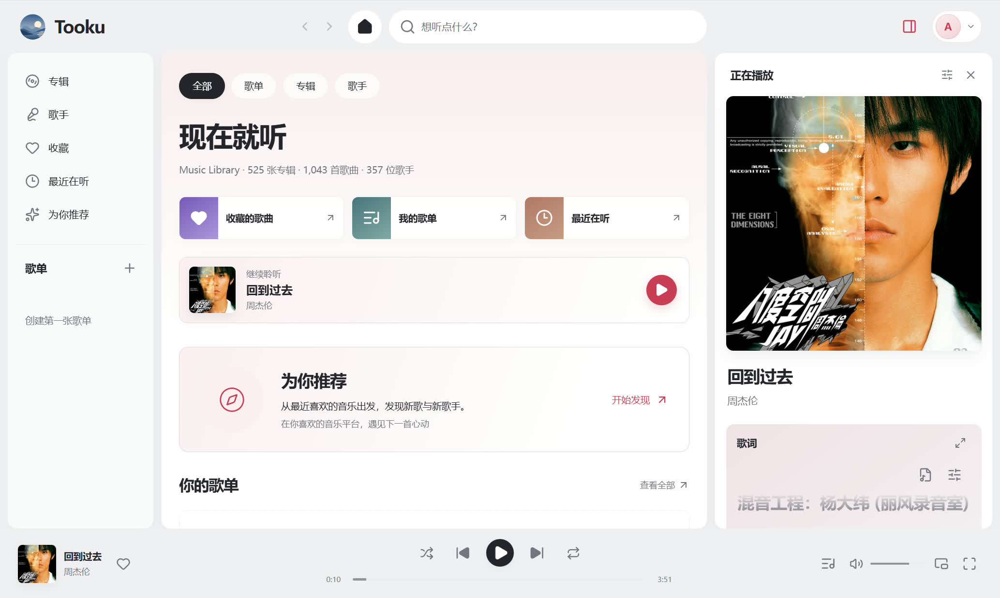
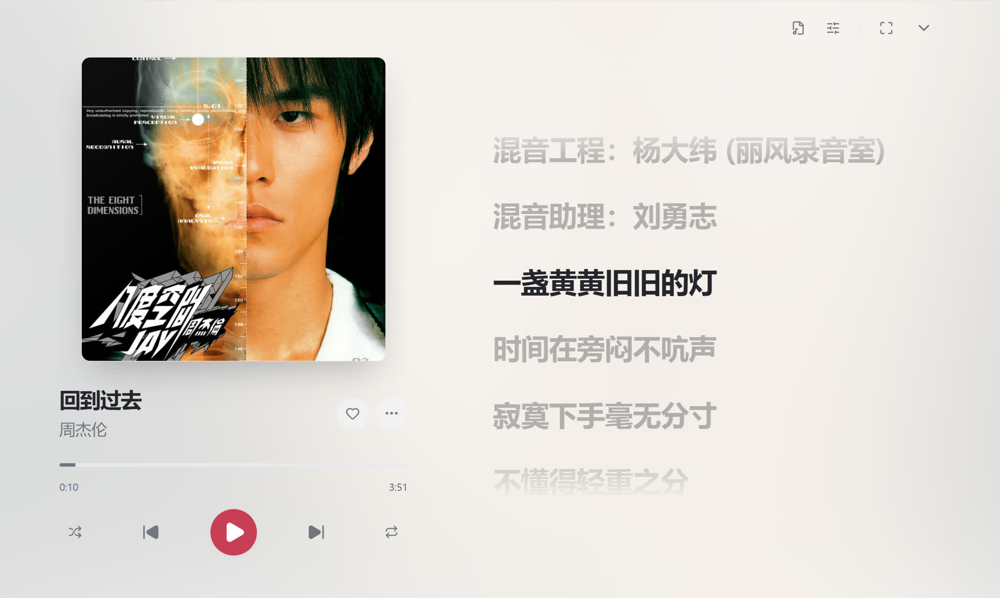

<p align="center"></p>

# Tooku

简体中文 · [English](docs/README_en.md)

Tooku 是一个 **Navidrome 第三方网页播放器**。本项目为**自用项目**，**完全使用 AI 构建**！

*Tooku 取自日语「遠く」，译为远方、远处的意思，在本项目中意为好听的音乐可以传播更远，也可以存在更久。*

## 特色功能

- [x] **看得过去的播放器**
- [x] **歌单管理**：歌单创建与编辑、曲目拖动排序、文件夹组织。
- [x] **网络歌词**：本地歌词优先，支持网易云 / QQ 歌词查询、双语显示、版本选择和时间偏移。
- [x] **AI 推荐**：可选接入 Last.fm 与 AI 服务，手动生成音乐推荐，并提供音乐平台链接跳转。
- [x] **PWA**：支持通过浏览器安装，以独立应用窗口访问。
- [x] **账号与个性化**：浅色 / 深色和主题色、自定义图片，按账号保存偏好、队列和历史，支持跨浏览器读取及数据导出、恢复。

## 界面截图

主界面：



歌词界面：



## 技术架构

Tooku 采用 React 单页应用与 Node.js 后端，同一个 Node 服务提供网页和 API，无需额外部署数据库服务。

| 层次 | 技术与职责 |
| --- | --- |
| 前端 | React、TypeScript、Vite、React Router |
| 状态与查询 | TanStack Query 管理服务数据，Zustand 管理播放状态与偏好 |
| 后端 | Node.js 内置 HTTP 与 SQLite，提供会话、账号数据、Navidrome 代理、歌词和推荐接口 |
| 数据保存 | SQLite 保存 Tooku 账号数据；IndexedDB 与本机存储保留浏览器缓存、快照和设备偏好 |
| 音乐服务 | Navidrome 管理音乐文件、曲库扫描、收藏、服务器歌单及转码 |

## 环境要求

| 环境 | 要求 |
| --- | --- |
| Docker | 镜像部署需要 Docker Engine 与 Docker Compose，当前镜像仅支持 Linux AMD64 |
| Node.js | 源码运行需要 24.22.1 或更新版本；Docker 部署无需在主机安装 |
| pnpm | 源码安装使用项目锁定的 11.25.0，可通过 `npx` 运行，无需全局安装 |
| Git | 克隆源码时使用；镜像部署可只下载 Compose 配置 |
| Navidrome | 已运行，且 Tooku 服务能够访问 |
| 浏览器 | 现代桌面或手机浏览器；远程部署使用 HTTPS |

## 项目结构

```text
Tooku/
├── .github/workflows/         # GitHub Release 触发的镜像发布工作流
├── src/                       # 前端与共享业务规则
│   ├── api/                   # API 请求与数据转换
│   ├── assets/                # 字体等构建资源
│   ├── components/            # 通用界面组件
│   ├── domain/                # 数据类型与业务规则
│   ├── features/              # 播放器、歌单、歌词、推荐等功能
│   ├── pages/                 # 登录、主页、搜索、设置等页面
│   ├── pwa/                   # Service Worker
│   ├── state/                 # 应用状态与偏好
│   └── storage/               # 浏览器存储与账号同步
├── server/                    # Node 后端与 SQLite 数据服务
├── public/                    # 品牌图片、PWA 清单与许可文本
├── scripts/                   # 启动、环境检查与维护工具
├── docs/                      # 英文说明、界面截图与第三方许可
├── .env.example               # 环境配置示例
├── compose.yaml               # 已发布镜像的 Docker Compose 配置
├── Dockerfile                 # Docker 镜像构建配置
├── package.json               # 项目信息、依赖与运行命令
└── pnpm-lock.yaml             # 依赖锁文件
```

## 快速开始

### 本地开发

1. 克隆项目：

   ```bash
   git clone https://github.com/Dewsweet/Tooku.git
   cd Tooku
   ```

2. 安装依赖：

   ```bash
   npx --yes pnpm@11.25.0 install --frozen-lockfile
   ```

3. 将 [.env.example](.env.example) 复制为 `.env`，填写实际的 Navidrome 地址，示例使用 `4533` 端口：

   ```dotenv
   NAVIDROME_UPSTREAM=http://127.0.0.1:4533
   ```

4. 启动开发服务：

   ```bash
   npm run dev
   ```

默认访问 `http://127.0.0.1:18733`，实际地址以终端输出为准。在登录页填写 Navidrome 地址，并使用其账号登录。

### 生产运行

安装依赖后执行：

```bash
npm run build
npm start
```

默认访问 `http://127.0.0.1:18733`，可通过 `TOOKU_HOST` 和 `TOOKU_PORT` 配置监听地址与端口。

生产 Node 服务的配置通过进程环境传入，不会自动读取开发用的 `.env`。若需加载上述 `.env`，可将 `npm start` 替换为 `node --env-file=.env server/index.ts`。网页与 API 需要由同一个 Node 服务提供，不能只静态托管 `dist`。

本机数据默认保存在 `.local/data`。迁移时保留数据与对应的加密密钥。

### Docker 启动
将以下内容保存为 `compose.yaml`，把 `NAVIDROME_UPSTREAM` 改为你的 Navidrome 地址，无需创建 `.env`：

```yaml
services:
  tooku:
    image: dewsweet/tooku:v0.1.0
    container_name: tooku
    restart: unless-stopped
    ports:
      - "18733:8080"
    environment:
      NAVIDROME_UPSTREAM: http://192.168.1.10:4533
      TOOKU_SECRET_KEY_FILE: /run/tooku-secret/tooku-secret.key
    volumes:
      - ./data:/data
      - ./secret:/run/tooku-secret
```

首次安装需先创建 `data` 和 `secret` 目录，并允许容器用户 `1000:1000` 写入。Linux 主机可在配置所在目录执行：

```bash
mkdir -p data secret
sudo chown 1000:1000 data secret
docker compose up -d
```

更新时修改 `image` 的版本标签，再执行：

```bash
docker compose pull
docker compose up -d
```

`data` 和 `secret` 分别保存数据和加密密钥，迁移时一起保留。已有部署继续使用原挂载；命名卷中的数据不会自动迁入这两个目录。

## 反馈
欢迎通过 [GitHub Issues](https://github.com/Dewsweet/Tooku/issues) 反馈问题，说明浏览器、部署方式、复现步骤和错误提示。
请勿附带密码、Cookie、认证 URL 或完整账号备份。

本项目以个人使用为主，后续根据实际使用情况维护。

## 许可证

Tooku 原创代码采用 [MIT License](LICENSE)，版权所有 © 2026 Dewsweet。

第三方依赖、思源字体和 Navidrome 图标保留各自许可证，详见[第三方许可说明](docs/THIRD_PARTY_NOTICES.md)。
