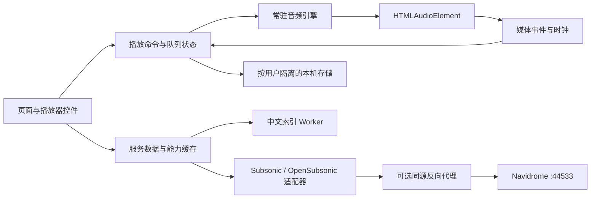

# 技术架构

状态：已创建第一版工程并固定依赖，实际实现与验证边界见 [开发记录](09-development-status.md)。React / Vite / Query / Zustand / IndexedDB 基线已采用；Radix 与 CSS Modules 暂未引入，当前用原生 dialog 管理弹窗焦点，使用统一 CSS token 和样式文件；后续复杂组件再按需要拆分。

## 技术选择与理由

| 层 | 建议 | 理由与边界 |
| --- | --- | --- |
| UI | React + TypeScript + Vite | 独立 SPA、静态部署；没有首版 SSR/SEO 需求；[React](https://react.dev/) 与 [Vite](https://vite.dev/guide/) |
| 路由 | React Router | 浏览器历史与页面参数；M0 确认版本与 base path 配置 |
| 服务数据 | TanStack Query | 请求去重、分页、失效与写入回滚；[官方说明](https://tanstack.com/query/latest/docs/framework/react/overview) |
| 客户端状态 | Zustand | 保存播放器与偏好；不同时复制一套完整服务数据；[作者仓库](https://github.com/pmndrs/zustand) |
| 样式/基础控件 | CSS variables + CSS Modules，Radix Primitives | 精细视觉控制与键盘/焦点基础；[Radix](https://www.radix-ui.com/primitives/docs/overview/introduction) |
| 音频 | HTMLAudioElement | 流式播放与浏览器后台媒体行为；Web Audio 只作后续可选处理 |
| 存储 | IndexedDB + 少量 localStorage | 大数据异步存储；localStorage 仅非敏感偏好 |
| 中文索引 | Web Worker + 增量元数据索引 | 避免拼音转换/建索引阻塞播放器；词典选型在 M4 完成 |
| 测试 | Vitest + Testing Library + Playwright | 核心算法、交互与真实浏览器分层验证 |

不直接采用播放器 UI 大组件管理核心状态，以免出现第二套队列。AMLL 如引入，仅接收统一歌词和时钟数据，不创建音频元素。

## 组件与数据流



直连模式可跳过代理。M0 先测浏览器直连，正式部署优先同源代理；反向代理转发请求，不把它说成隐藏浏览器凭据的 BFF。

## 目录建议

```text
src/
  app/                 路由、providers、AppShell、全局错误边界
  pages/               登录、首页、音乐库、歌单、设置
  features/
    auth/              凭据内存、连接验证、退出
    library/           列表、分页与浏览逻辑
    search/            服务查询、输入法处理、结果合并
    playlists/         写入事务与编辑状态
    player/            引擎、队列算法、控制栏、Media Session
    lyrics/            解析、适配、同步与覆盖
  api/                 transport、DTO、errors、capabilities、adapters
  domain/              Track、Album、QueueEntry、Lyrics 等统一模型
  storage/             IndexedDB schema、迁移与命名空间
  workers/             搜索索引与后续耗时处理
  components/          通用控件、封面、状态视图
  styles/              design tokens、主题与基础样式
tests/                 契约样本、核心单测、E2E
deploy/                后续静态服务、反向代理与容器配置
docs/                  本次规划文档
```

## 核心领域契约（示意）

```ts
type Milliseconds = number;
type Seconds = number;

interface Track {
  id: string;
  title: string;
  artists: Array<{ id?: string; name: string }>;
  albumId?: string;
  albumName?: string;
  durationSec?: Seconds;
  coverArtId?: string;
  discNumber?: number;
  trackNumber?: number;
  suffix?: string;
  bitRateKbps?: number;
}

interface QueueEntry {
  entryId: string; // 同一 trackId 可重复出现，entryId 必须不同
  trackId: string;
}

interface LyricsDocument {
  trackId: string;
  source: 'server' | 'user' | 'online';
  timing: 'none' | 'line' | 'word';
  offsetMs: Milliseconds;
  lines: Array<{
    startMs?: Milliseconds;
    endMs?: Milliseconds;
    text: string;
    translation?: string;
    pronunciation?: string;
    words?: Array<{ startMs: Milliseconds; endMs: Milliseconds; text: string }>;
  }>;
}
```

这些是内部设计模型，不是伪造的服务端 JSON。适配器负责旧字段/多歌手、新歌词字段的转换；保留原 DTO 仅用于脱敏契约调试。

## 状态边界

TanStack Query 负责专辑、歌手、歌单、收藏和服务能力。查询 key 包含服务标识、账号范围和必要的库筛选；没有认证 token。登出先中断请求，清除用户 Query 缓存，防止晚到响应进入新账号。

播放器 store 负责队列、当前 entry、循环、随机、用户播放意图；引擎负责媒体元素和事件，UI 只发命令。时间秒值从音频读取，歌词时钟局部更新，避免全局 store 每帧驱动整棵 React 树。

编辑歌单是独立草稿状态：读取快照 → 本地编辑 → 一次保存 → 重新读取验证。乐观收藏失败回滚；歌单写入不能重放不明结果的非幂等操作。

## 存储与身份隔离

命名空间由规范化服务 URL（含 base path）与账号身份共同组成。API key 模式登录后需得到稳定身份；若无法确认，使用独立配置 ID，不能合并不同 key 的用户缓存。

| 数据 | 位置 | 清理与迁移 |
| --- | --- | --- |
| 密码/API key/token+salt | 默认只在内存 | 登出、切服务、关页失效；不进入 state persist |
| 主题、字号、动效偏好 | localStorage | 可按用户分组；不含私密音乐数据 |
| 队列、暂停进度、本机历史 | IndexedDB | versioned schema；损坏时单表回退，不破坏服务数据 |
| 元数据索引、歌词覆盖 | IndexedDB | 按服务/用户分区；退出默认清私人缓存，保留需用户选择 |
| PWA 资源 | CacheStorage（P1） | 只缓存应用壳；首版排除认证 API 和媒体流 |

恢复队列只保存曲目 ID/条目 ID 与位置，不保存签名 URL。恢复后重新获取权限和流地址；无权限曲目提示失效。

## 中文搜索增强（P1）

服务端查询与本地辅助索引并行，结果以 track/album/artist ID 去重。索引仅覆盖已同步的可访问元数据；索引界面显示进度与覆盖范围。不能通过“服务端搜索不到的候选结果”生成全库拼音命中。

全量同步采用可分页的已验证接口，M4 再决定遍历专辑还是空查询 search3；暂停/限速/恢复、库删除与权限变化要支持。搜索排序：原文完全匹配 → 别名/繁简 → 拼音 → 首字母；多音字和同名异版保留用户修正入口。

## 安全与部署边界

浏览器收到的凭据可被同源脚本读取；本机加密若密钥同处客户端，不能等同于安全密钥库。长期“记住登录”暂不进 P0；若做须独立设计并说明存储风险。

认证 URL 仅即时用于音频/图片请求；日志、错误上报、截图诊断去掉 u/p/t/s/apiKey。封面需受认证保护时应按 ID 缓存内容，不能把带认证 URL 永久保存。

HTTP 仅用于本机开发；远程部署使用 HTTPS。静态资源 self-host，设置 Referrer-Policy 与 CSP，在需要的情况下精确允许媒体/图片 origin。若后续实现自建代理接收任意服务器 URL，另做上游白名单与 SSRF 约束；当前仅固定上游反向代理。
