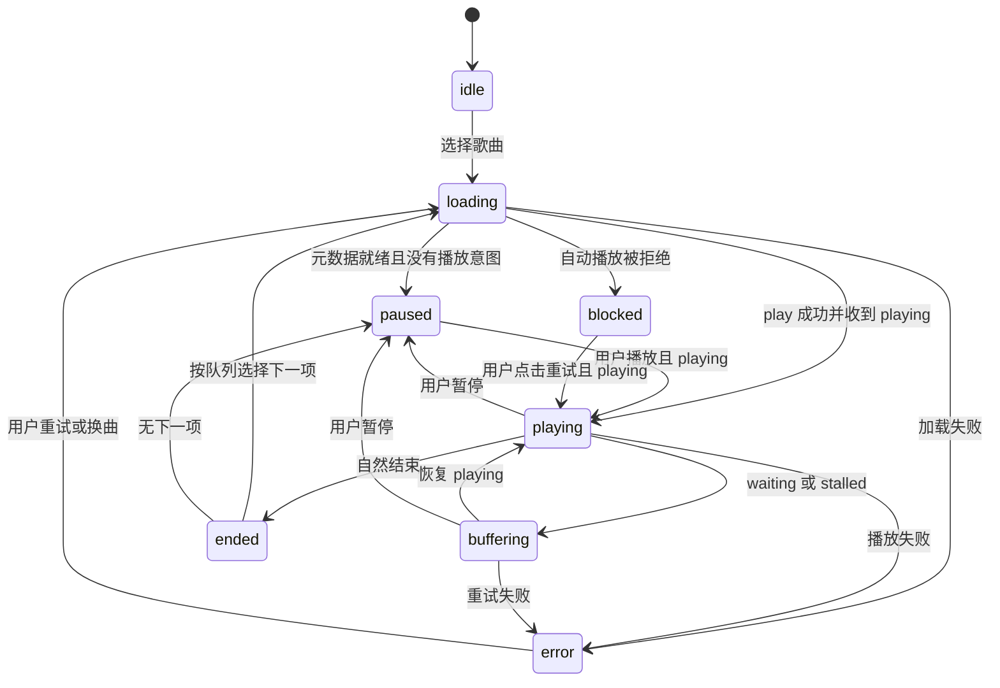

# 播放器与歌词设计

目标：播放持续、操作可预期、队列可恢复。首版使用一个常驻 HTMLAudioElement；播放器 UI、全屏歌词和路由切换不能重新创建音频引擎。

## 生命周期与状态机

图中为主路径；任意状态的换曲进入 loading，退出/清空播放器进入 idle。状态区分“用户希望播放”和“实际正在发声”：点击后不立刻假设已播放，playing 事件才作为实际播放证据。

每次换曲增加 generation/request ID，取消旧元数据/歌词请求并废弃旧 play promise 结果。媒体回调还需确认当前资源和 generation；不能让慢响应把新歌标题、歌词或状态改回旧歌。

在 AppShell 范围初始化/销毁一次引擎，React StrictMode 和热更新下也要保证监听器成对清理、不产生双音频。仅退出服务、关闭应用或显式销毁才释放实例。

## 队列模型与规则

保存 ordered entries、currentEntryId、shuffle 顺序、实际播放 history、repeatMode、恢复位置和 schemaVersion。同一歌曲可出现多次，每次有独立 entryId。UI 所见顺序应等于实际下一首顺序。

| 情况 | 明确行为 |
| --- | --- |
| 顺序播放尾项结束 | repeat=off 停止；all 返回首项；one 自然结束时重播当前项 |
| 用户点下一首 | one 模式也前进；off 的尾项停止；all 尾项回到首项 |
| 用户点上一首 | 当前已播放超过 3 秒先回到 0；否则沿实际历史返回 |
| 手动加入下一首 | 插入实际顺序，连续插入保持加入顺序，不被随机模式再次打散 |
| 移动当前项 | 按 entryId 保持播放和进度，只改变后续队列位置 |
| 删除当前项 | 停止当前源，选删除位置的后继；按原用户播放意图继续或暂停；无后继按循环规则处理，空队列进入 idle |
| 切随机 | 固定当前项，未播放部分生成稳定随机顺序；退出随机恢复原始相对顺序 |
| 一首音频失败 | 有限重试后提供跳过；自动跳过最多连续 3 项，随后暂停说明原因 |
| 恢复队列 | 当前项权限和存在性重新检查，恢复为暂停；点击后从可用位置继续 |

下一首和自然结束由统一 transition 函数处理，避免 ended 回调与按钮竞争跳两首。撤销队列替换仅恢复队列/当前位置及用户明确的播放意图，不复用过期流地址。

## 时间、进度与播放意图

音频时钟以 currentTime 秒为准，内部歌词/持久进度转换成毫秒；duration 可能暂时未知，进度条等 loadedmetadata 后启用，并根据 seekable 验证目标位置。

拖动时 UI 显示预览时间，松手提交 seek；取消拖动回到真实时间。seeked 后立即校正歌词与进度；不要用累计 setInterval 值作为音频时间。缓冲指示可来自 buffered，但已下载范围不等于可定位范围。[MDN 时间范围说明](https://developer.mozilla.org/en-US/docs/Web/Media/Guides/Audio_and_video_delivery/buffering_seeking_time_ranges)

本机快照建议播放中每 5 秒节流写入，并在暂停、换曲、队列修改时保存；pagehide 仅作尽力补充，不能依靠关页时完成异步写入。按用户范围与 schema 迁移恢复。

## 音频格式与音质

先用浏览器 canPlayType 作为提示，再以实际播放结果验证。原始流无法解码时使用服务器允许的兼容转码；码率/格式切换涉及重新取流，应保留用户意图和位置，并验证新流能否 seek。

原始流 Range 与转码流不是同一语义。转码服务可能无 Content-Length 或有限 seek 能力；不能用单个请求头承诺完整拖动支持。转码 offset 扩展仅在声明与实际验证后启用。

MVP 不将整首音频 fetch 后 decodeAudioData 作为常规播放方案，避免大文件内存成本和下载后才能播放。音质页可显示源文件信息与请求策略；只有可靠服务/流证据才标为实际输出格式。网页端不承诺 bit-perfect。

浏览器或移动系统不允许软件音量控制时，用明确提示和系统音量替代失效滑条；功能检测与实机结果共同决定。

## 歌词来源与同步

默认优先级：用户为该曲明确选择的本机覆盖 → 服务端结构化歌词 → 服务端静态歌词 → 用户开启后的在线候选。在线匹配需用户可见的来源和版本信息，网络失败不打断声音。

歌词高亮按实际 currentTime 查找时间区间，使用二分查找定位当前行；只有页面可见且播放时按需 requestAnimationFrame 更新逐词动画。暂停、seek、换曲、后台恢复立即同步。后台不依赖 rAF 做播放或收听记录。

内部统一 offset 语义：有效歌词时间 = audio.currentTime×1000 − 已归一化的源延迟 − 用户延迟；正延迟表示歌词晚显示。源格式 offset 的正负按各自规范转换，不原样叠加；点击歌词跳到行开始时间加总延迟后的音频时间。用正负偏移样本验证，避免双重应用。

P0 逐行显示和静态文本；P1 支持逐词/译文/注音、多轨。AMLL 候选只负责显示，不参与曲目匹配、队列或音频时钟；引入前完成许可证与低性能设备实验。

手动滚动暂时停止自动跟随，显式“回到当前”或短暂空闲后按设置恢复。减少动态效果模式使用固定高亮和普通滚动；主歌词/翻译字号分开设置。

## 收听记录与重复上报

Navidrome 的 stream 请求不自动产生已播放记录；传统 scrobble 按 [服务兼容说明](https://www.navidrome.org/docs/developers/subsonic-api/)实现。建议产品阈值为实际有效收听达到 min(时长的一半, 240 秒)，30 秒以下短曲完整结束提交；这是客户端策略，不是协议要求。

有效收听以连续媒体时间推进与实际 playing 区间核算：暂停、缓冲、seek 跳过的部分不累计，未知 duration 时采用有限保守阈值并在元数据就绪后校正。每次播放 occurrence 有唯一标识，同一 occurrence 最多成功提交一次；重复播放是新的 occurrence。

若有 [playbackReport](https://opensubsonic.netlify.app/docs/extensions/playbackreport/)，状态上报用 ignoreScrobble=true，收听计数仍由显式 submission=true 负责。没有扩展则使用传统 submission=false 的 now playing 方式。两条路径不重复发送同义状态。

写入超时可能已被服务器处理，重试不具备端到端 exactly-once 保证。保留“结果未知”状态并避免盲目重放；不宣传绝无重复计数。本机历史表示已发生的本机收听，与服务端提交结果分开保存。

## Media Session、后台与多标签页

按 [Media Session 能力](https://developer.mozilla.org/en-US/docs/Web/API/Media_Session_API)注册播放、暂停、下一首、上一首与 seek handler，更新 metadata、playbackState 和有限频率的 positionState。无支持浏览器保持页面控件可用。

同用户多个标签页通过 BroadcastChannel（可用时）协调：新标签页要接管时先请求旧页暂停，再获取播放 ownership；没有可靠协调则提示可能同时播放，不错误展示全局单实例保证。

手机后台、锁屏、系统音频焦点和 PWA 行为须实机验收；浏览器可能冻结页面。睡眠定时在恢复时按截止时间重新检查；不会承诺后台定时器始终准确。初次播放处理 [自动播放限制](https://developer.mozilla.org/en-US/docs/Web/Media/Guides/Autoplay)，显示可点击的继续按钮。

## 高级音频能力准入（P2）

2026-10-14 主播放界面的平滑进度由音频元素的 currentTime 驱动，仅进度组件以约 25fps 刷新；暂停/减少动态效果时读取媒体事件更新的状态，隐藏页面不提交动画状态。歌词继续按媒体位置和 offset 定位，用户滚动暂停跟随，点击“回到当前歌词”恢复。装饰性播放状态柱不表示真实频谱。

| 能力 | 实验前提 | 通过条件 |
| --- | --- | --- |
| ReplayGain / EQ | Web Audio、可访问媒体源、AudioContext 用户激活 | 不静音、不削波；缺元数据回退；后台不破坏播放 |
| Crossfade | 双路资源与音量调度，仅独立实验 | 不改变首版单实例生命周期；大文件、弱网和暂停可靠 |
| 无缝播放 | 编码 padding、预加载、浏览器调度/解码验证 | 连续专辑用样本量化间隙；不把 preload 宣传为真正 gapless |
| 离线音频 | 完整资源缓存、Range、配额与权限清理 | 清晰显示已缓存范围/大小；未缓存歌曲解释不可用 |

以上默认关闭，单独结论写入技术验证记录后才进入产品开关。
