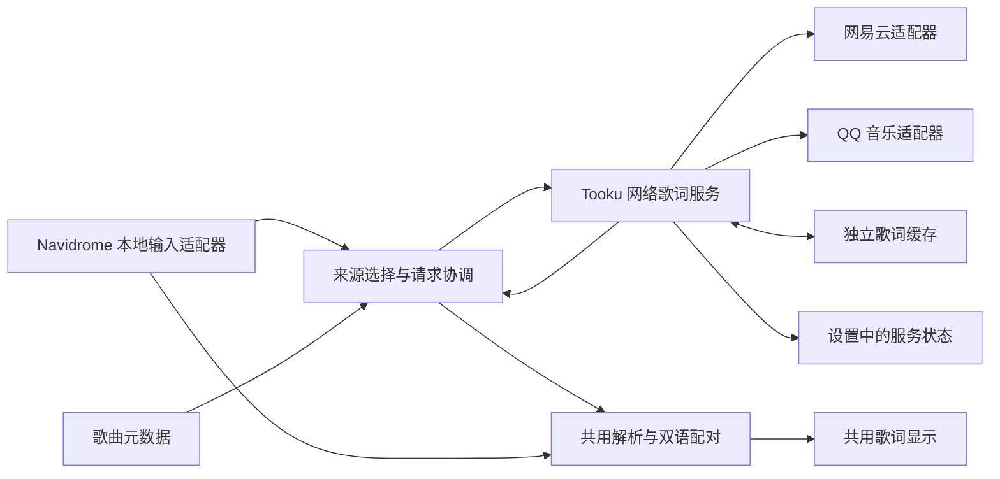

# Tooku 独立歌词组件方案

日期：2026-10-20。状态：**设计稿，尚未实现**。本文件补充网络歌词与双语歌词设计，不代表已有服务、设置入口或实际平台可用性。本轮只维护文档，不增加接口、依赖、数据库结构或后台进程。

## 1. 已确定的边界

- 歌词系统属于 Tooku，以独立模块随 Tooku 启动和部署；不需要在 Navidrome 安装插件，也不绑定其歌词扩展能力。
- 默认本地优先，明确缺失时自动联网；始终允许手动选择来源。
- Navidrome 是现有本地歌词的输入渠道。网络搜索、获取、匹配、解析、缓存和检测由 Tooku 自己负责；模块能在没有 Navidrome 的测试环境运行。
- 本地和网络歌词统一显示原文与已有译文。Tooku 不生成翻译，不把外语歌等同于一定存在中文译文。
- 展开播放器继续保持左侧固定、右侧歌词独立滚动、右上角收起，不恢复队列切换和底部设置排布。只增加一个简洁的歌词来源入口。
- 切换来源、译文显示、排版方式或偏移不重建音频、不改变队列与播放进度；继续使用既有 player 与 QueryClient。
- 音乐与歌词标签不自动写回。整张专辑缺歌词也按歌曲逐首匹配，不在播放过程中批量扫描或改写音乐文件。

本方案沿用的默认行为：本地存在可读外语原文但缺中文译文，仍视为本地歌词存在，不自动替换；用户可选择网络版本。该规则属于当前方案默认值，后续若增加“优先双语”，应作为明确选项讨论，不悄悄改变默认。

以下平台顺序、缓存期限、请求预算和数据字段是实施建议，须在接口验证及样本分析后定稿。尚未决定采用哪个第三方包、也未验证平台当前免登录可用。

## 2. 首版范围与实施入口

首版包含本地歌词整理、网易云与 QQ 来源、逐行同步、原文与中文译文配对、手动匹配、按歌排版修正、缓存及设置中的真实服务状态。罗马音字段可保留，默认不显示。

逐字动画、AI 翻译、平台扫码登录、音频指纹识别、标签写回、后台全库补全、音乐平台播放功能及独立部署服务均不在首版范围。当前本地输入仍为 Navidrome 返回的文本/结构化歌词，不承诺网页可以直接读取服务器音乐文件的标签或相邻 LRC 文件。

现有入口及需要解决的问题：

| 入口 | 当前事实 | 计划变化 |
| --- | --- | --- |
| `src/api/client.ts` 的 `MusicApi.lyrics` | 结构化歌词只选一份；普通返回按文本分行 | 本地适配器保留可用版本、语言、原始行序和时间信息，交给共用整理模块 |
| `src/domain/models.ts` 的 `Lyrics` | 单行只有文本与可选开始时间 | 引入独立歌词文档与歌词组；通过兼容转换逐步替换现有类型 |
| `src/features/player/Lyrics.tsx` | 获取、跟随与显示在同一组件 | 获取与选择由歌词 hook 协调，显示共用歌词组及现有滚动逻辑 |
| `src/pages/Settings.tsx` | 没有网络歌词服务区 | 增加网络开关、来源优先顺序和服务状态 |
| `vite.config.ts` / `server/index.ts` | 分别挂载开发/生产 API | 共用一个歌词 HTTP handler，不维护两套实现 |
| `src/domain/userData.ts` / `src/storage/userSync.ts` | 共享账号白名单与整体 revision 同步 | 实施持久化阶段增加可选歌词设置，保留旧数据和既有冲突保护 |

## 3. 模块划分与依赖方向



建议目录如下，均为计划文件，尚不存在：

```text
src/domain/lyrics/              纯类型、LRC 解析、双语配对、时间换算
src/api/lyrics.ts               独立 TookuLyricsApi：请求、DTO、错误转换
src/features/lyrics/            来源协调 hook、来源菜单、匹配选择、排版修正
src/features/settings/         网络歌词设置与运行状态
server/lyrics/                 服务工厂、HTTP handler、缓存、匹配、状态
server/lyrics/providers/       网易云与 QQ 的独立适配器
scripts/probe-lyrics.ts         只读接口检测，独立于 Navidrome
```

网络服务只接受歌曲检索信息或平台歌曲 ID，依赖注入 fetch、缓存和时钟，不导入 `MusicApi`、Subsonic 认证、播放引擎或用户同步模块。平台适配器共用 `search` / `fetchLyrics` 能力与错误类型，独立更换一个来源不影响其他来源或播放器。

前端继续通过现有 Provider 获取本地 `MusicApi`。新的网络客户端与本地客户端同层，由 Tooku 歌词上下文提供稳定实例，复用当前 QueryClient；不能强制构造 `MusicApi` 才能使用网络服务。现有“协议请求集中在 client.ts”的约定保留给 Navidrome；独立歌词请求集中在 `src/api/lyrics.ts`，实施时同步更新开发规范，页面不自行拼接口 URL。

开发与生产均在原 Tooku HTTP 端口挂载服务，不新增常驻端口。歌词缓存故障降级到受限内存缓存，来源故障只影响对应来源；用户数据 API 和音乐代理继续工作。关闭 Tooku 时清理歌词计时器、请求、连接与缓存资源。

## 4. 统一数据契约

建议使用以下领域对象，字段及限制在实施阶段形成运行时白名单：

| 对象 | 主要内容 |
| --- | --- |
| `TrackDescriptor` | 歌名、歌手列表、可选专辑、时长（毫秒）、已知版本信息；不含认证 URL、音频数据或账号凭据 |
| `LocalLyricInput` | 本地原始文本/结构化版本、语言、源偏移、原始行序、内容 hash；仅在前端整理，不因解析而上传本地全文 |
| `LyricCandidate` | provider、平台歌曲 ID、标题、歌手、专辑、时长、版本信息、匹配依据；不以平台 ID 冒充本库 track ID |
| `LyricDocument` | 格式版本、来源及记录 ID、原始歌词文本、源偏移、原文/译文/罗马音各轨、正文状态和解析版本 |
| `LyricGroup` | 稳定组 ID、可选 startMs/endMs、原文行数组、译文行数组、可选罗马音、输入行引用及配对可信度 |
| `LyricChoice` | `auto` / `local` / `network`，网络来源为 `auto` / `netease` / `qq`，可选人工绑定、排版方式及分来源偏移 |

同一时间点允许有多句原文，不把所有第二行都归为译文；翻译也允许换成多行。副歌重复、相同文本不同时间、多时间标签产生的出现次数均保留，不按文本去重。

正文状态至少区分 `lyrics`、明确 `instrumental` 和 `not-found`。网络错误、取消、权限错误、解析失败不塞进空的 `lines` 冒充无歌词。来源明确返回纯音乐时展示“纯音乐”；空串或无时间戳本身不能证明纯音乐。

内部所有歌词时间统一毫秒，音频仍为秒。OpenSubsonic 正 offset 表示提前，进入本地适配器时转换成 Tooku 延迟语义，后续只用一套计算：

```text
显示用歌词时间 = 音频秒数 × 1000 − 文档源延迟 − 当前来源的用户延迟
点击歌词定位秒数 = (原文 startMs + 文档源延迟 + 当前来源的用户延迟) / 1000
```

译文配对、当前组判断和点击定位均以原文时间轴为基准。单个来源各语言轨的独立源 offset 先转换到共同时间基准，再对齐；用户延迟在配对完成后应用。旧全局 lyricDelay 保留为兼容基准，新按歌/来源的值在其基础上叠加，避免迁移时无声丢失旧设置。具体产品调整入口放到来源菜单内，不恢复底部设置区。

## 5. 本地歌词整理与双语配对

先保留原始版本与输入顺序，再规范换行、BOM、时间标签与必要的实体编码，最后解析与配对。歌词作为纯文本渲染，不将上游内容作为 HTML 执行。

### 判断顺序

1. 优先使用来源明确标识的原文/译文轨和语言；本地服务返回的多个结构化版本不能在此之前只选一份。
2. 对齐同一来源的独立时间轴，先匹配相同时间点；存在小误差时在受限窗口内做单调、一对一匹配，容差同时受相邻歌词间隔约束，避免快速段落误绑下一句。
3. 结合全曲格式、文字特征、语言标记与时序判断同一行、交替行和前后分段。
4. 证据不足保留原始文本，不丢行、不制造时间戳，允许用户按歌曲修正。

| 输入格式 | 自动处理条件 | 无法确定时 |
| --- | --- | --- |
| 外语与中文隔连续空格 | 多行存在一致分隔，两侧内容支持双语判断 | 保留原文；不能按普通单空格拆英文 |
| `外语 / 中文` | 多行结构一致、两侧语言证据充分 | 保留斜杠，避免破坏歌词中的正常符号 |
| 原文行后紧跟译文 | 语言/轨信息或相同时间戳支持配对；静态文本需稳定交替模式 | 保留多行顺序，不单凭奇偶行拆分 |
| 前半原文、后半中文 | 区块边界、时间轴回绕/对应及语言证据一致 | 不机械对半；可手动选择分段模式与边界 |
| 两份独立的结构化语言版本 | 来源语言与时间轴相容 | 保留各版本；语言不明时不标成中文翻译 |

日文汉字不等同中文，拉丁文字不一定是罗马音；混合语言、括号注音和合唱均需反例测试。前后区块必须在全局排序前识别，避免时间轴排序破坏分段证据。多个原文轨同时出现时保留其原文语义。

首版排版修正提供“自动 / 保持原样 / 同一行双语 / 交替双语 / 前后分段”。分隔或边界不唯一时，在同一个修正弹窗中让用户指定并预览；用户确认前不保存。排版修正绑定歌曲、来源和原始内容 hash，源内容变化后保留旧规则但不盲目套用，可再次选择；“恢复自动”不修改原始歌词。

静态双语可以按可靠结构组成组，但仍为静态，不因组数与歌曲时长已知而伪造同步。缺少中文时显示原文，不显示空译文占位，也不自动调用机器翻译。每个来源默认使用自己的原文与译文，跨来源拼接不在首版范围。

## 6. 默认选择、手动选择与失败行为

优先级为：当前用户对该歌曲的明确选择 > 本地优先自动策略。来源切换按歌曲保存，不影响下一首没有选择记录的歌曲。

| 模式/结果 | 行为 |
| --- | --- |
| 自动，本地有可读正文 | 显示本地；静态或缺译文也算有正文，不发自动网络请求 |
| 自动，本地明确空/只有元信息 | 查询已启用网络来源，建议初始网易云→QQ；顺序可调整 |
| 自动，本地明确纯音乐 | 显示“纯音乐”，停止自动补齐；允许用户主动选网络 |
| 本地读取超时、失败或无权限 | 保留具体本地状态与重试，不能当成空歌词；仍可手动选网络 |
| 明确本地模式 | 只显示本地结果，无正文时显示“暂无歌词”，不自动联网 |
| 网络自动模式 | 跳过本地，按已启用网络来源顺序匹配与获取；一处失败可以尝试下一处 |
| 指定网易云或 QQ | 严格使用该来源；失败、无匹配或无歌词时提供重试/更换匹配，不偷偷换来源 |
| 用户恢复自动 | 清除该歌的强制来源选择，重新执行本地优先；人工候选绑定可保留以便之后使用 |
| 关闭网络歌词 | 不发自动、预取或检测请求，不自动选网络；网络选择入口禁用，保留缓存和已有个人选择以便重新启用 |

已经显示的有效歌词，不因低优先级结果晚到、状态检测或后台缓存更新突然替换。首次本地加载不能用短超时冒充“无歌词”抢先展示网络；网络自动模式按优先顺序决策，不采用“哪个先响应就显示哪个”。

切歌、换账号、改变来源或人工候选时，取消过期请求并检查请求代次；旧请求完成不能覆盖当前曲目或来源。右栏和展开页共享歌曲/来源级选择与缓存，各自管理自己的滚动视口。

本地查询 key 保留 `api.identity` 与 track ID；网络获取 key 包含 provider、平台 ID、适配版本，按歌协调 key 再包含账号身份和本库 track ID。真正依赖曲库的匹配带播放来源曲库 ID，不用用户刚切换的浏览曲库给正在播放的歌曲重新绑定身份。匿名网络接口不接收客户端 identity 作为账号权限依据。

## 7. 网络搜索、候选选择与请求控制

### 匹配步骤

先使用人工绑定；没有绑定再搜索并比较歌名、歌手、专辑、时长与版本。全半角、大小写、常见标点及明确别名可用于匹配，但保留原始信息供用户检查。Live、伴奏、翻唱、重混和 TV Size 等不能直接当作无关括号删除；明确版本冲突默认不自动接受。

高可信且明显优于第二候选才自动取用；同名、缺歌手/时长、版本不明等情况返回少量候选让用户选择。候选弹窗显示歌名、歌手、专辑、时长和来源，不播放平台音频。可编辑搜索关键词、更换候选、重新搜索和解除绑定。评分门槛与时长容差根据样本验证，不在调研阶段宣称匹配准确率。

选中歌曲后若歌词为空，可继续尝试同来源其他可靠候选或网络自动模式的下一来源，但每次请求受总预算限制；无法可信匹配时停止，不能为了填满界面接受低分歌曲。已有正文但无译文属于有效歌词，不循环搜索直至必有译文。

### 建议请求预算

- 只为当前歌曲按需请求，首版不预取整张专辑；同 key 并发请求合并，多个视口不重复搜索。
- 单次上游请求建议超时 5 秒，一次来源决策总预算建议 15 秒；最多两来源、每来源最多一次搜索和两首候选的歌词读取。最终数值由第一阶段实测校准。
- 平台级并发建议不超过 2，配合请求间隔；遇到限流尊重服务端重试时间，并进行有上限的退避。
- 没匹配/没歌词可短期负缓存；超时、429、登录要求和协议变化不写成永久无歌词。
- 开放的来源与上游域名由服务端白名单固定，不支持客户端提交任意抓取 URL；账号凭据和 Navidrome 请求头不转发给平台。

首版保留普通 LRC/静态歌词作为显示基线。平台只有 YRC/QRC 时，需要在独立适配器确认解码和行级降级可行性；无法可靠解析则返回格式不支持，不能把加密或逐字控制串当歌词展示。逐字动画不作为首版接入的前提。

## 8. HTTP 契约与独立访问边界

计划使用独立 `/api/lyrics/` 命名空间，在现有用户数据鉴权 handler 之外挂载，避免调用歌词服务必须先向 Navidrome 验证。以下均为拟议接口，不是已存在的 API：

| 方法与路径 | 用途 |
| --- | --- |
| `GET /api/lyrics/health` | 组件版本、运行状态、缓存状态；不探测平台、不触发启动时联网 |
| `GET /api/lyrics/status` | 返回平台最近观测及新鲜度；读取本身无外部请求 |
| `POST /api/lyrics/check` | 用户主动检测允许的来源，分别验证搜索与歌词能力，合并重复检测并限流 |
| `POST /api/lyrics/search` | 根据受限元数据返回少量规范候选和各来源结果，不返回原始 HTTP 响应 |
| `POST /api/lyrics/fetch` | 根据 provider/recordId 读取歌词，支持缓存读取策略；不接受认证 URL |

响应统一携带格式版本与明确结果类型，如 `found`、`not-found`、`instrumental`、`ambiguous`；HTTP 状态和上游业务错误分别检查。参数错、服务停用、限流和上游错误分别返回明确语义，不能 HTTP 200 加空正文掩盖故障。

网络服务的首版接口是受限公开检索，**同源检查不是用户身份认证**：不读取私人绑定或返回账号数据，不转存 Cookie，不提供任意代理；服务级开关、Origin/Fetch Metadata 检查、JSON 请求限制、输入与响应大小限制及请求预算共同限制调用。公开部署应沿用部署入口的访问控制；本次不增加另一套 Tooku 账号系统，也不以“客户端已登录”冒充服务端鉴权。

个人选择继续经 Tooku 现有账号同步保存，owner 由已有已验证会话决定。账号同步当前依赖固定上游验证这一事实不改变；独立的是歌词查询/解析/检测能力，不把身份同步改造成新认证方案。直连其他 Navidrome 的账号可用同源网络歌词服务，但个人选择仅在本机按原有 identity 隔离，不能借此写入固定上游账号。

## 9. 缓存、个人数据与迁移

| 数据 | 计划保存位置 | 生命周期与隔离 |
| --- | --- | --- |
| 平台歌词原文/译文/罗马音文本及规范结果 | 独立 `lyrics-cache.sqlite`，位于 Tooku 数据目录 | 可共享公开平台记录；不保存完整响应头、认证字段、用户本地歌词全文 |
| 搜索结果及失败查询 | 内存或受限缓存 | 搜索请求结束即可释放，不作为个人绑定；无正文与请求失败分开 |
| 人工候选绑定、来源选择、排版规则、偏移及开关/顺序 | 账号文档可选 `lyrics` 区域与既有 IndexedDB sync 缓存 | 按账号及本库 track ID 保存，进入账号导出/恢复与 revision 检查 |
| 近期平台观测、退避状态 | 内存 | 重启后为未检测，不把旧正常状态当作当前实测 |

缓存库与 `tooku.sqlite` 用户库分开：缓存可重建，不让歌词抓取不断推进账号 revision 或占据 12 MB 账号文档。使用独立 schema 版本、保留式迁移和受限容量；建议起始限制 100 MB/5000 条、单文档 512 KB，先达到任一限制时按最近使用回收，最终阈值待样本校准。缓存不可写时退回受限内存，不删除用户数据库。

建议成功结果缓存 7 天，明确无匹配/无歌词缓存 6 小时；有有效旧缓存时可显示并标记为缓存结果，在低频受控刷新后才于下次读取采用新版本。人工“重新搜索”绕过搜索负缓存，“刷新歌词”绕过正文缓存，均不绕过限流。缓存命中不会刷新平台的最近联网成功时间。

缓存 key 包含 provider、平台记录 ID、所取轨道和适配版本；规范结果带解析版本，可以从已保留的歌词文本重新整理。按歌曲的自动匹配还需元数据指纹，歌名/版本/时长改变后重评自动匹配；人工绑定保留，不在后台静默换成另一歌曲。

账号文档 `lyrics` 使用可选兼容字段，旧文档缺省即为本地优先、网络启用、初始平台顺序、自动排版和无按歌覆盖；保持旧 `lyricDelay` 基准，不把空默认抢先写成个性数据。实施前同步更新 `isUserData`、同步捕获/应用、备份校验和大小限制；409/结果未知仍停止写入并读回，导入不接管当前音频。

恢复旧备份时，缺少歌词区意味着恢复默认策略及清除当前账号的新增按歌覆盖；其他账号与平台缓存不变。账号备份包含个人选择，不包含可重新获取的歌词缓存；完整 `tooku.sqlite` 备份同样不依赖缓存库，恢复后按需重建。不得清空浏览器数据作为迁移步骤。

## 10. 服务状态与界面

设置中的“网络歌词”提供账号开关、网易云/QQ 优先顺序、平台启用选择及“检测”。配置开关改变本账号的请求策略，不关闭其他账号正在使用的服务；部署级总开关与账号偏好分开。

服务本身显示“运行中 / 已停用 / 降级”，平台显示“未检测 / 可用 / 部分可用 / 限流 / 需要登录 / 暂不可用”。状态背后保留最近成功时间、观测时间、请求耗时、错误分类和搜索/歌词两项能力；展开详情再显示技术原因，不在设置默认视图堆小字。

“可用”要求最近实际完成并验证对应业务响应；HTTP 200、健康端点有响应、命中缓存或某首歌无匹配均不足以标绿。单曲未收录不降低整个平台状态。建议 30 分钟后标记观测过期并显示“待检测”；不在后台频繁探测，也不因播放进度更新重复请求。

手动检测使用维护的公开测试记录，分别验证搜索与正文读取，不使用用户当前听的私人元数据作为检测样本。返回空内容需区分测试记录失效和平台整体故障，不能用一个样本武断判定全部歌曲不可用；具体检查记录与判定在接口验证阶段确定。

展开页仅显示一个当前来源按钮，菜单提供“自动（本地优先）/ 本地 / 网络（自动）/ 网易云 / QQ 音乐”。菜单中标明当前选择，按钮显示实际来源；正在获取时保留选择状态，失败时显示简短正文状态及必要重试。更换匹配、排版修正、偏移与译文/罗马音显示放进该菜单或其弹窗，不额外常驻来源、格式和统计说明。

原文为大字主行，已有中文译文位于下方、字号稍小但保持可读，整组随当前时间高亮并几何居中。右栏使用同一数据与选择，保留紧凑排版。字体、换行、译文开关或容器尺寸改变后重新测量整组高度；只滚动自己的歌词视口，保留键盘、焦点恢复、中文 IME 与减少动态效果。

## 11. 来源参考与维护方式

2026-10-20 已阅读以下上游代码。该事实只证明存在相应实现，不代表当前网络、地区、匿名权限和限流条件下可用，也不构成选包结论：

| 参考 | 研究内容 | 许可与使用边界 |
| --- | --- | --- |
| [NeteaseCloudMusicApiEnhanced](https://github.com/NeteaseCloudMusicApiEnhanced/api-enhanced) 的 [lyric_new.js](https://github.com/NeteaseCloudMusicApiEnhanced/api-enhanced/blob/main/module/lyric_new.js)、[cloudsearch.js](https://github.com/NeteaseCloudMusicApiEnhanced/api-enhanced/blob/main/module/cloudsearch.js) | 网易云搜索、新版歌词请求及参数 | 仓库 [LICENSE](https://github.com/NeteaseCloudMusicApiEnhanced/api-enhanced/blob/main/LICENSE) 为 MIT；复用时保留许可与来源 |
| [L-1124/QQMusicApi](https://github.com/L-1124/QQMusicApi) 的 [lyric.py](https://github.com/L-1124/QQMusicApi/blob/main/qqmusic_api/modules/lyric.py) | QQ 歌词原文、译文、罗马音请求，ID/MID 分支 | [GPL-3.0](https://github.com/L-1124/QQMusicApi/blob/main/LICENSE)，不能把具体代码直接当作 Tooku 原创代码 |
| [jsososo/QQMusicApi](https://github.com/jsososo/QQMusicApi) 的 [lyric.js](https://github.com/jsososo/QQMusicApi/blob/master/routes/lyric.js) | QQ 另一种歌词接口及原文/译文 Base64 解码 | [GPL-3.0](https://github.com/jsososo/QQMusicApi/blob/master/LICENSE)，作为兼容路径研究，实际可用性待测 |
| [LDDC](https://github.com/chenmozhijin/LDDC) 的 [algorithm.py](https://github.com/chenmozhijin/LDDC/blob/main/LDDC/core/algorithm.py) | 标题版本、歌手与多语言歌词匹配的既有处理 | 文件标注 GPL-3.0-only；只读研究不等于已经引入依赖或代码 |

实施阶段先实测两平台匿名搜索、歌词、译文、超时及格式变化，再确定最小必要依赖或适配实现。若采用上游代码或包，固定版本/commit、记录具体文件和修改、维护第三方许可；不依赖随机公共中转站，不引入登录、推荐、下载和音频解锁等无关模块。GPL 代码的采用方式需在实际复用前明确，不能通过改名或挪进独立目录当作消除许可要求。

每个适配器维护协议版本、失败语义、固定响应样例和只读 probe；上游改变时优先替换适配器。匿名访问不可用时如实标为需要登录/不可用，不为完成首版悄悄增加平台凭据持久化。平台登录若将来确有需求，应单独设计凭据边界。

## 12. 分阶段实施与验证范围

1. **来源可行性验证**：独立只读 probe 验证两个平台搜索/正文/译文，记录明确可用条件、数据格式及实际复用许可。样本含中文、日语、英语、同名不同歌手、Live/伴奏及无歌词；结果保存在 `.local`，文档只汇总，不保存凭据或整份版权歌词。
2. **本地双语与共用模型**：先改本地输入、多轨保留、纯解析/配对及共用显示，处理四种格式和排版修正。用合成样例测试，实际问题歌曲只读核对。保留单语/静态回退、原偏移与播放连续性。
3. **独立网络服务**：实现两适配器、受限 HTTP、匹配、缓存和真实状态；在没有 Navidrome 的环境用注入响应运行，开发/生产共用 handler。平台故障不阻断另一个来源或用户数据服务。
4. **来源选择与个人保存**：接入自动/指定来源、候选弹窗、设置状态及可选账号字段；覆盖默认值、旧数据/旧备份、直连账号、冲突、导入和缓存失败回退。
5. **收敛交付**：补源顺序、迟到请求、双视口共用、重复歌词、时间换算和结构迁移的必要边界测试；执行适用的 Lint、构建及测试，审阅 diff，按可审阅范围本地提交，更新接入指南和 README 的实现状态。

单元与集成测试使用合成歌词及固定脱敏响应，不依赖平台实时网络、不修改真实用户歌单或标签。详细功能与视觉仍由人工查看；实施交付时在最终回复简列需看的项目，不另建人工验收清单文档。

进入实现前仍需在第一阶段收敛的事项：两个平台实际匿名可用条件与最终复用方案、真实本地歌词样例是否经 Navidrome 保留分隔/多轨信息、匹配阈值和请求/缓存参数。它们不影响已确定的产品边界，也不代表本轮已经获准启动实现。
